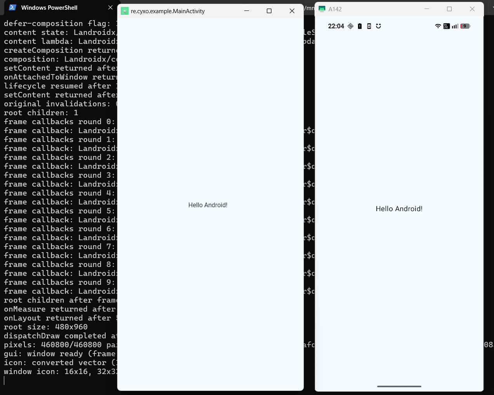

# Tartine - Android Runtime

<p align="center">
  
</p>

> **Tartine** *(noun)*: A slice of bread topped with sweet or savoury spreadable food such as butter, jam, honey, cream, or sauce.

### Tartine Android RunTime Is Not an Emulator.

Tartine is a tool to run Android apps on Desktop OSes natively, in a similar fashion to [Wine](https://www.winehq.org/).

## Scope

- **Supported target: pure-DEX apps.** Java/Kotlin/Compose apps whose APK ships no native code. Apps bundling ARM `.so` libraries (Flutter, most games) are out of reach for now: a desktop JVM cannot load Bionic-built ARM binaries.
- **Status:** the headless pipeline drives a real Compose APK through manifest → DEX → VM into lifecycle, composition, and the first measure pass. The first rendered frame now blits into a real desktop window (Skia raster through the LWJGL GL context — `mise run gui`), and the window carries the app's launcher icon: the manifest `android:icon`/`roundIcon` reference resolves through `resources.arsc`; bitmap sources decode through Skija and vector/adaptive icons (incl. aapt2 inline gradients and group transforms) convert to SVG and render through jsvg at 16/32/48 px. Unsupported sources log an `icon:` gap line and fall back to the platform default icon. Next milestone: the ASM translation spike. Design decisions and roadmap live in `AGENTS.md`.

## What currently works

Tartine can currently parse **pure-Kotlin/Java APKs** (no XML layouts or images) and render their first frame.

<p align="center">
  
  <i>On the left, the app run by Tartine. On the right, the same app running on a real Android device, mirrored with scrcpy.</i>
</p>

It finds the main activity in the XML manifest, and also extracts the icon from the resources.

For now, there is no render loop, no events handling and no inter-process communication (such as intents).

## Prerequisites

- [mise](https://mise.jdx.dev/). JDK and Gradle install automatically
  from `mise.toml` on first verify (`mise install` is
  idempotent). No manual toolchain setup. Code must stay compatible with
  Java 21: `build.gradle` enforces `options.release = 21`.
- After editing `mise.toml`, run `mise trust` (mise distrusts modified
  configs).
- **Dev-time oracle JARs** (baksmali, apktool) are not in the repo.
  Fetch them once after cloning:

  ```sh
  sh scripts/fetch-tools.sh
  ```

## Verify

```sh
sh scripts/verify.sh
```

Trusts + installs toolchains via mise, then runs `gradle test`.
Single test/class:

```sh
mise exec -- gradle test --tests "tartine.apk.*"
```

## APK probes

```sh
mise run apk [apks/app-debug.apk]              # manifest, code, and library summary
mise run run [apks/app-debug.apk]              # translated headless probe: onCreate until the first gap
mise run gui [apks/app-debug.apk] [timeout]    # translated GUI probe: show the activity window (first frame blits)
mise run dump <file.dex>                       # instruction dump of one dex file
```

`run` and `gui` execute the launcher as real JVM bytecode through the
translation loader (`tartine.tx`). The interpreter path is still reachable
directly for comparisons: `java ... tartine.Main irun|igui [apk]`.

`mise tasks ls` lists everything; `mise run <task> --help` shows args.
Launchers reuse the last `mise run build` output via direct `java`
(no recompile when unchanged).

## Configuration

An optional `config.properties` lives in the per-user Tartine folder (the
same one the virtual filesystem uses). A missing file means all defaults.
It is host-side only: a guest never sees the file itself, only the values
it changes.

Location (whole folder moves with the `TARTINE_HOME` env or the
`tartine.home` system property):

| OS | Path |
|---|---|
| Windows | `%LOCALAPPDATA%\Tartine\config.properties` |
| macOS | `~/Library/Application Support/Tartine/config.properties` |
| Linux | `~/.local/share/tartine/config.properties` (respects `$XDG_DATA_HOME`) |

Keys (unknown keys or bad values are warned on stderr and skipped):

```properties
# One Android system color resource per line: overrides what the host
# answers when an app calls getColor. The key is the canonical
# android.R.color constant name - the spelling every ROM overlay
# customizes (each manufacturer overlays different values for the same
# names; AOSP colors.xml is the baseline this translation layer serves).
# A decimal or 0x numeric id works too. Value: Android hex notation
# (#RRGGBB answers opaque, #AARRGGBB literal), 0xAARRGGBB, or plain
# decimal. Example (the sample app renders exactly this pair): the
# Surface paints from the scheme's background slot and the text from its
# paired content slot (contentColorFor ties the "on" color to the drawn
# color - an app painting the surface slot instead reads
# system_on_surface_light):
color.system_background_light = #102433
color.system_on_background_light = #E7EBEF

# Comma-separated desktop font families, tried in order when a Paint has
# no explicit typeface. Precedence: this key > TARTINE_FONT_FAMILIES env
# > built-in list (Roboto, Segoe UI, Noto Sans, DejaVu Sans,
# Liberation Sans, Helvetica Neue).
font.families = Segoe UI, Roboto

# Shared storage (the guest /sdcard tree). Default: a private virtual
# card at <root>/sdcard, seeded with Download, Documents, Pictures,
# DCIM, Music and Movies on first run - apps can read and write it, but
# nothing outside the Tartine folder is reachable.
#
# An explicit mount points /sdcard (and /storage/emulated/0) at an
# existing host directory instead - opt in, Wine-style. The directory
# must be absolute, must already exist, may not be a junction or symlink
# (mount the real location), never a filesystem root, and never a
# folder that encloses the Tartine root. Spell Windows paths with
# forward slashes: the JDK properties parser treats a lone backslash as
# an escape and would eat it. The mount is READ-ONLY unless this flag
# clears it:
sdcard.mount = C:/Users/me/Downloads
# sdcard.mount.readonly = false
```

Environment knobs:

- `TARTINE_HOME` / `tartine.home` - move the root folder itself (config
  file included).
- `TARTINE_SDCARD` - the same override as `sdcard.mount` when the config
  key is absent (the config file wins). Same directory validation and
  read-only default.
- `TARTINE_FONT_FAMILIES` - same family list as `font.families` (the
  config file wins).
- `TARTINE_MAX_STEPS` - caps the interpreter step counter for the
  headless probes (dev tool).

Guest files: apps only ever see Android paths. App-private dirs
(`/data/data/<pkg>`, `/data/user/0/<pkg>`, `/data/local/tmp`) map under
the Tartine root; `/sdcard` maps to the card tier above; device trees
(`/system`, `/proc`, `/dev` and friends) do not exist. Every guest file
operation goes through this mapping (`java.io.File`), unmapped paths
answer as nonexistent, and read-only mounts deny writes - the guest
never learns a host path. Raw `java.nio.file`/`java.io` stream classes
stay inaccessible to guest code. Planned (decided in `AGENTS.md`, not
wired yet): per-folder user maps (`/sdcard/Download` -> `~/Downloads`),
file-picker grants, whole-home mounting as an explicit read-only option.
Every configuration knob documents here in the same commit that lands
it (`AGENTS.md` commits rule).
