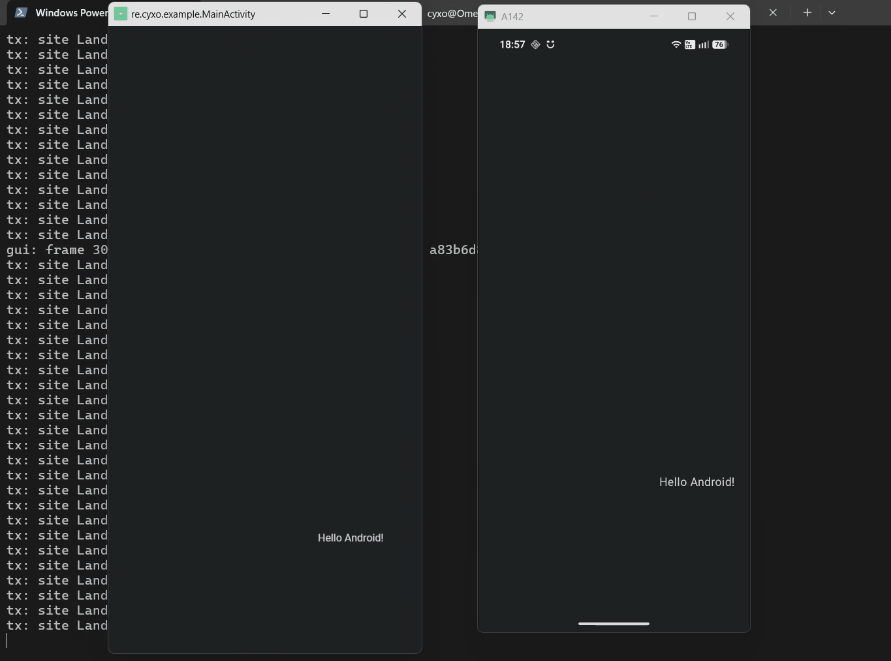

# Tartine - Android Runtime

<p align="center">
  
</p>

> **Tartine** *(noun)*: A slice of bread topped with sweet or savoury spreadable food such as butter, jam, honey, cream, or sauce.

### Tartine Android RunTime Is Not an Emulator.

Tartine is a tool to run Android apps on Desktop OSes natively, in a similar fashion to [Wine](https://www.winehq.org/).

> **Trust model:** Tartine is a compatibility layer, in the spirit of Wine: it
> runs Android apps you trust. It is **not** a security sandbox and does not
> isolate apps from your system. A malicious APK can do anything your user
> account can do. Run only apps you would run as a normal desktop program. The
> Android-style permission prompts are a convenience and fidelity feature, not
> a security control. See [ADR-0012](docs/adr/0012-trust-model.md).

## Scope

- **Supported target: pure-DEX apps.** Java/Kotlin/Compose apps whose APK ships no native code. Apps bundling ARM `.so` libraries (Flutter, most games) are out of reach for now: a desktop JVM cannot load Bionic-built ARM binaries.
- **Status:** the headless pipeline drives a real Compose APK through manifest -> DEX -> VM into lifecycle, composition, and a continuous measure/layout/draw loop (60 Hz by default; `display.refresh_hz`). Frames blit into a real desktop window (Skia raster through the LWJGL GL context - `mise run gui`), whose framebuffer size and content scale drive the guest viewport and density (live resizes included), and the window carries the app's launcher icon: the manifest `android:icon`/`roundIcon` reference resolves through `resources.arsc`; bitmap sources decode through the renderer backend and vector/adaptive icons (incl. aapt2 inline gradients and group transforms) convert to SVG and render through jsvg at 16/32/48 px. Unsupported sources log an `icon:` gap line and fall back to the platform default icon. The translation pipeline (DEX -> JVM bytecode, `tartine.tx`) is the only VM; framework behavior grows per probe wall. Design decisions and roadmap live in `docs/architecture.md`.

## How it works

When running `mise run gui [file.apk]`, the APK file is parsed and the DEX bytecode is translated to JVM bytecode in real time.

The Android Framework (that exists as a DEX bytecode JAR file on Android devices) has been recreated in the `framework` module here, and re-implements Android features with desktop APIs from the Java Virtual Machine.

The native window, events and rendering pipeline are handled by GLFW, and require a UI adapter. The current UI adapter provided in the `gfx-skija` module relies on Skija (Java bindings library for Skia), but the Tartine GUI has been designed to be modular, so any Java module implementing `gfx-api` could be used to render UI in Tartine.

## Features

Tartine can currently parse **pure-Kotlin/Java APKs** (no XML layouts or images) and keep their Compose UI animating in a live render loop.

<p align="center">
  
  <i>On the left, the app run by Tartine. On the right, the same app running on a real Android device, mirrored with scrcpy.</i>
</p>

> Current Android Framework coverage: ~11.9%
> 
> 

Here's a list of currently working features:
- **Pure-DEX apps (Java/Kotlin/Compose, no XML layouts, no native code) run end-to-end** - manifest parsing, DEX -> JVM translation (the only VM), lifecycle/composition, and a continuous measure/layout/draw loop; framework behavior is added wall-by-wall via named `UnsupportedOperationException` gaps surfaced by `mise run run`/`refs`. *Limitation: `mise run run` halts at the first named gap on headless runs until the family is ported.*
- **Full 60 Hz render loop for pure-Compose apps, configurable via `display.refresh_hz` (1–1000, fractional OK)** - `tartine.graphics.RenderLoop` drains host events, pumps `Choreographer`, redraws only when a callback ran or a view is dirty, reuses one readback buffer, and presents the newest frame through `HostDisplay`; idle screens cost a blit. The guest viewport is the window framebuffer and guest density is the window content scale (a 2x window keeps the same dp layout), with live window resize replacing the surface and forcing a redraw at the new size. A failed draw is logged once and stops the loop (the partial raster is not presented), instead of retrying a wedged traversal such as Compose's "layout state is not idle" on every VSync; `display.debug_frames` adds per-frame hash/painted stats. *Limitation: pacing is the guest render loop only; the window still presents at the desktop monitor's VSync (`glfwSwapInterval(1)`); if a frame's draw+readback costs more than the period, the effective rate is capped by draw speed. A resize does not deliver an activity configuration-change callback; the running app keeps its startup `Configuration` until relaunch.*
- **Real desktop window rendering via Skia on LWJGL** - `Canvas` ops rasterized with Skija, read back as ARGB, uploaded as a GL texture and letterboxed per frame; window stays hidden until the first posted frame, then timeout starts. The window opens at 480x960 by default and its actual framebuffer size/resizes drive the guest viewport. *Limitation: software raster path only; no GLES/Vulkan-native UI or `ANativeWindow` path yet (architectural seam exists, not wired).*
- **App icon extraction** - manifest `android:icon`/`roundIcon` resolves through `resources.arsc`; bitmaps decode through the renderer; adaptive/vector icons convert to SVG (aapt2 inline gradients and group transforms) rendered at 16/32/48 px; unconverted sources log an `icon:` gap and fall back to the OS default.
- **Host display threading + event channel** - one host UI thread owns GLFW/GL and a separate guest looper thread; input/resize/focus/close events publish on the display thread, buffer until registration, replay, and post to the guest `Looper` `MessageQueue`; `postFrame` returns `false` on close.
- **Virtual filesystem** - guest paths (`/data/data/<pkg>`, `/sdcard`) map under the Tartine root; default private card with seeded Download/Documents/Pictures/DCIM/Music/Movies; optional shared host mount (`sdcard.mount`, read-only by default, validated for safety); `TARTINE_SDCARD` env fallback.
- **Guest sandbox** - restricted classloader + SDK-free runtime; a ported File bridge and `Class.forName` helper; translation-time gating of blocked members; sandbox policy surfaced as `tartine.tx.SandboxPolicy`. A compatibility/accident boundary, not a security sandbox ([ADR-0012](docs/adr/0012-trust-model.md)).
- **Host configuration** (`config.properties`): per-color overrides, font families, `theme.mode` (`auto`/`light`/`dark`), sdcard mount + read-only flag, `display.refresh_hz`, `display.debug_frames`; host theme auto-probes the Windows registry, macOS `defaults`, GNOME/KDE.

*Global limits: no XML layouts or non-icon images; no ARM `.so` native libraries; no IPC/intents; no input dispatch into the view tree (events reach the queue, but GLFW->Android key/motion mapping and ViewRootImpl-style delivery are gaps); graphics are software-raster only for now.*

### Upcoming features

- **Input dispatch into the view tree** - GLFW-to-Android `KeyEvent`/`MotionEvent` mapping and ViewRootImpl-style focus/key/motion delivery.
- **Hardware/GLES path** - future `GLES`/`ANativeWindow`/`Surface` use alongside Skia, atop the livewired `gfx-api`/`gfx-skija` seam (only software raster UI today).
- **Surface/Window layers** - `SurfaceView` own layer and `TextureView` inside-app GLES compositing semantics at the host level.
- **Shared-storage / IPC layer** - intents and inter-app communication (design notes only today).
- **Installation, daemon, packaging** - per-user unprivileged daemon, signature verification + install/unpack, AppCDS, Unix-domain IPC (design notes in `architecture.md`).
- **Framework family ports** - ongoing per-probe gap filling (`View`, measure, nested touch, accessibility, etc.) driven by `refs`; `KeyboardNavigationCluster`, `Autofill`, etc. remain named gaps.
- **Guest-facing VSync Choreographer equivalence beyond animation** - callbacks driven by `pumpFrameCallbacks` today, not a native VSync receiver.
- **`SurfaceFlinger`-grade behaviors** - z-order, transforms, HWC (window management beyond one window + timeout).

## Prerequisites

- [mise](https://mise.jdx.dev/). JDK and Gradle install automatically
  from `mise.toml` on first verify (`mise install` is
  idempotent). No manual toolchain setup. Code must stay compatible with
  Java 21: `build.gradle` enforces `options.release = 21`.
- After editing `mise.toml`, run `mise trust` (mise distrusts modified
  configs).
- **Dev-time oracle JARs** (baksmali, apktool) are not in the repo.
  Fetch them once after cloning:

  ```sh
  sh scripts/fetch-tools.sh
  ```

## Verify

```sh
sh scripts/verify.sh
```

Trusts + installs toolchains via mise, then runs `gradle test`.
Single test/class:

```sh
mise exec -- gradle test --tests "tartine.apk.*"
```

Pre-commit gate (style + bug/security analysis on every commit):

```sh
mise run fetch-tools                            # once: Checkstyle jar for the hook
mise generate git-pre-commit --write --task=pre-commit
```

The hook runs the suite only when a test source is staged, then Checkstyle on
the staged Java and the PMD/SpotBugs gate across modules. See
`config/checkstyle/`, `config/pmd/ruleset.xml` and
`config/spotbugs/exclude.xml`; the generated `framework/src/main/java`
skeletons are excluded from all three.

## APK probes

```sh
mise run apk [apks/app-debug.apk]              # manifest, code, and library summary
mise run run [apks/app-debug.apk]              # translated headless probe: onCreate until the first gap
mise run gui [apks/app-debug.apk] [timeout]    # translated GUI probe: show the activity window (Compose frames animate)
mise run coverage                               # estimate framework method coverage (logic vs. auto-generated stubs)
mise run dump <file.dex>                       # instruction dump of one dex file
mise run refs [apks/app-debug.apk]             # unresolved-reference census (guest dex, then host)
mise run strict [apks/app-debug.apk] [filter]  # translator-gap gate over every class
```

`run` and `gui` execute the launcher as real JVM bytecode through the
translation loader (`tartine.tx`), the only VM. `txrun`/`txgui`/`txdump`
remain as aliases for `run`/`gui`/`dump`.

`refs` is the probe-wall companion: run it when `run`/`gui` stops at a
`Tartine: not implemented` gap, or before porting a framework family. It
resolves every method, field and type reference plus class-hierarchy edge
before translation (guest dex first, then host reflection) and prints each
unresolved one as `kind reference: reason`:

- `owner class not found` - the class is absent from both the APK and the
  framework; add/port it.
- `member not found` - the owner exists but lacks the method/field; add it
  to the skeleton or behavior.
- `type not found` - a parameter, return, field or catch type is missing.

Real APKs produce a large census; redirect it and grep the failing signature:

```sh
mise run refs apks/app-debug.apk > build/refs.txt
```

It is a census, not a gate: translation still degrades an unresolved method
body to its named `UnsupportedOperationException` gap on first use. A
signature absent from the census points at behavior (or a translator bug),
not missing linkage.

`strict` is the translator-correctness gate: it translates every class with
degradation disabled, lists each method the translator cannot translate, and
exits non-zero when any remain. Sandbox denials are expected boundaries and
are shown only as an aggregate. Pass a class descriptor substring (for
example `Landroidx/compose/`) to sweep one package first.

`mise tasks ls` lists everything; `mise run <task> --help` shows args.
Launchers reuse the last `mise run build` output via direct `java`
(no recompile when unchanged).

## Configuration

An optional `config.properties` lives in the per-user Tartine folder (the
same one the virtual filesystem uses). A missing file means all defaults.
It is host-side only: a guest never sees the file itself, only the values
it changes.

Location (whole folder moves with the `TARTINE_HOME` env or the
`tartine.home` system property):

| OS | Path |
|---|---|
| Windows | `%LOCALAPPDATA%\Tartine\config.properties` |
| macOS | `~/Library/Application Support/Tartine/config.properties` |
| Linux | `~/.local/share/tartine/config.properties` (respects `$XDG_DATA_HOME`) |

Keys (unknown keys or bad values are warned on stderr and skipped):

```properties
# One Android system color resource per line: overrides what the host
# answers when an app calls getColor. The key is the canonical
# android.R.color constant name - the spelling every ROM overlay
# customizes (each manufacturer overlays different values for the same
# names; AOSP colors.xml is the baseline this translation layer serves).
# A decimal or 0x numeric id works too. Value: Android hex notation
# (#RRGGBB answers opaque, #AARRGGBB literal), 0xAARRGGBB, or plain
# decimal. Example (the sample app renders exactly this pair): the
# Surface paints from the scheme's background slot and the text from its
# paired content slot (contentColorFor ties the "on" color to the drawn
# color - an app painting the surface slot instead reads
# system_on_surface_light):
color.system_background_light = #102433
color.system_on_background_light = #E7EBEF

# Comma-separated desktop font families, tried in order when a Paint has
# no explicit typeface. Precedence: this key > TARTINE_FONT_FAMILIES env
# > built-in list (Roboto, Segoe UI, Noto Sans, DejaVu Sans,
# Liberation Sans, Helvetica Neue). If none of the requested families is
# installed, the renderer falls back to its bundled Roboto face, so text
# still draws instead of failing the lookup.
font.families = Segoe UI, Roboto

# Render-loop refresh rate in frames per second. Default 60; fractional
# values (59.94, 119.88) work too. The guest frame clock (Compose's
# withFrameNanos) ticks at this rate; the desktop window still presents
# at the monitor's own VSync. Accepted range: 1-1000.
display.refresh_hz = 60

# Render-loop diagnostics. false (the default) keeps per-frame output
# off; true logs callback counts, raster hashes and painted-pixel totals
# while probing. The hash and count scan the whole frame, so leave it
# off outside diagnostics.
# display.debug_frames = false

# Log level for the host/runtime/guest logger (java.util.logging):
# TRACE, DEBUG, INFO, WARN, ERROR or OFF. Default INFO. The command
# line --log-level / -l takes precedence over this key (highest
# priority first). Guest android.util.Log calls map onto the same
# levels; the console prefixes each line with its caller class.
# Diagnostics go to stderr; command results stay on stdout.
# log.level = INFO

# Host light/dark theme. auto (default) follows the desktop setting when
# it can be read: Windows AppsUseLightTheme, macOS AppleInterfaceStyle,
# or GNOME/KDE on Linux. light/dark force the guest Configuration night
# bit. Read once at startup, so restart after changing the OS setting.
theme.mode = auto

# Shared storage (the guest /sdcard tree). Default: a private virtual
# card at <root>/sdcard, seeded with Download, Documents, Pictures,
# DCIM, Music and Movies on first run - apps can read and write it, but
# nothing outside the Tartine folder is reachable.
#
# An explicit mount points /sdcard (and /storage/emulated/0) at an
# existing host directory instead - opt in, Wine-style. The directory
# must be absolute, must already exist, may not be a junction or symlink
# (mount the real location), never a filesystem root, and never a
# folder that encloses the Tartine root. Spell Windows paths with
# forward slashes: the JDK properties parser treats a lone backslash as
# an escape and would eat it. The mount is READ-ONLY unless this flag
# clears it:
sdcard.mount = C:/Users/me/Downloads
# sdcard.mount.readonly = false
```

Environment knobs:

- `TARTINE_HOME` / `tartine.home` - move the root folder itself (config
  file included).
- `TARTINE_SDCARD` - the same override as `sdcard.mount` when the config
  key is absent (the config file wins). Same directory validation and
  read-only default.
- `TARTINE_FONT_FAMILIES` - same family list as `font.families` (the
  config file wins).

Every configuration knob is documented here in the same commit that lands it.

## Guest sandbox

This is a compatibility and accident boundary, not a security boundary: guest
code runs in the same JVM and process as Tartine, so it cannot contain a
malicious APK (ADR-0012). It keeps an app on the virtual filesystem and makes
host capabilities explicit.

Apps only ever see Android paths. App-private dirs
(`/data/data/<pkg>`, `/data/user/0/<pkg>`, `/data/local/tmp`) map under
the Tartine root; `/sdcard` maps to the card tier above; device trees
(`/system`, `/proc`, `/dev` and friends) do not exist. Every guest file
operation goes through this mapping (`java.io.File` and the file-backed
`FileInputStream`/`FileOutputStream`/`FileReader`/`FileWriter`/
`PrintStream`/`PrintWriter` constructors), unmapped paths answer as
nonexistent, and read-only mounts deny writes - the guest never learns a
host path. Every access rechecks the real path, so a symlink or junction
inside a mount cannot point outside it. `java.nio.file` and `FileDescriptor`
stay inaccessible.

Translated code runs behind a restricted classloader (ADR-0009). Host
capabilities outside the file bridge are denied by name: network
(`java.net.*`), process spawning (`Runtime.exec`/`ProcessBuilder`),
`FileDescriptor` and non-file stream classes, `java.nio.file`/
`java.nio.channels`, host internals (ASM, Skija, `tartine.*`), environment
variables, and process control (`Runtime.exit`/`halt`, shutdown hooks,
`System.exit`, `System.load`). Narrow guest facades cover what libraries
legitimately probe: read-only `Runtime` memory/CPU queries,
`System.getProperty` with a value allowlist (unknown keys answer the
caller's default), reflection over guest-declared members only, class
lookup through a `GuestClassLoader` and gated `Class.forName`, an empty
`ServiceLoader` ("no providers"), and Vfs-routed file streams (so Kotlin's
`File.readText()`/`readBytes()` work).
Reflection metadata types (`Method`, `Field`, `Constructor`) stay loadable
because app signatures mention them; host-declared members are filtered
from plural lookups, answer "not found" from `getMethod`/`getField`, and
are refused with a named denial at invoke/access. Denied calls surface as
named `UnsupportedOperationException` gaps at first use, never as silent
success.

Planned (decided in ADR-0005, not wired yet): per-folder user maps
(`/sdcard/Download` -> `~/Downloads`), file-picker grants, whole-home
mounting as an explicit read-only option.
